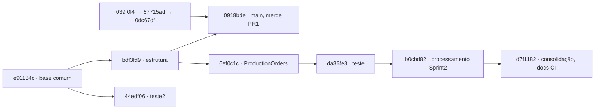

# 03 — Análise de branches e preservação Git

Referência: 11/11/2026. Repositório local: `D:\Projetos\devilman\smart40-expedicao-oee`. A origem corresponde a [GabbeSant/smart40-expedicao-oee](https://github.com/GabbeSant/smart40-expedicao-oee). Recomenda-se **consolidacao-sprint2**, condicionada à confirmação do formato acadêmico “biblioteca sem tela” e à integração pendente.

## Estado inicial registrado antes da inspeção de conteúdo

| Item | Observação confirmada |
| --- | --- |
| Branch ativa | `consolidacao-sprint2` |
| HEAD | `d7f11828d0304c1a1088309715d04b00ef8ec356` |
| Tracking | `origin/consolidacao-sprint2`, ahead0/behind0 |
| Branches locais | `main` em 0918bde; `consolidacao-sprint2` em d7f1182 |
| Branches remotas reais | `main`, `teste`, `teste2`, `consolidacao-sprint2` |
| Referência adicional | `origin/HEAD → origin/main`; não é quinta branch |
| Alterações rastreadas não commitadas | Nenhuma no status inicial |
| Arquivos novos não rastreados | Nenhum |
| Arquivos ignorados visíveis ao Git | Nenhum na inspeção com --ignored |
| Local versus remoto vivo | Os quatro SHAs locais de tracking coincidem com a listagem autenticada do GitHub |

A validação remota usou [GET branches](https://api.github.com/repos/GabbeSant/smart40-expedicao-oee/branches?per_page=100), com quatro resultados. Não foi necessário `git fetch`: os objetos já estavam presentes e as pontas foram conferidas pelo conector. Não foram usados checkout, switch, reset, stash, merge, rebase, worktree, commit ou push. Comparações por `git show`, `ls-tree`, `log`, `merge-base`, `rev-list` e `diff`, sem alterar a árvore.

## Matriz técnica

SHAs completos e datas abaixo são das pontas efetivamente conhecidas, não de cópias baixadas em outro momento.

| Branch / commit | Data da ponta (UTC−3) | Objetivo aparente | Tecnologias / organização | Funcionalidades comprovadas no código |
| --- | --- | --- | --- | --- |
| main · [0918bde](https://github.com/GabbeSant/smart40-expedicao-oee/commit/0918bde53a3a15ec0f7719aa976e600c523f4ed1) | 28/10/2026 21:03 | Demonstração integrada ao histórico principal | React/TS/Vite; FrontEnd; 33 arquivos; 2 arquivos de testes | Dashboard mock, produção simulada, fila/lotes/rack, premissas D/P/Q, CSV e impressão, persistência local |
| teste · [da36fe8](https://github.com/GabbeSant/smart40-expedicao-oee/commit/da36fe8f08b9a1623eab5fa430d9ea1652d73332) | 28/10/2026 21:56 | Preparar leitura das ordens SMART 4.0 | Base React/TS/Vite + cliente fetch/DTO/adaptador; 42 arquivos; 5 de testes | Tudo da demonstração + GET /api/productionOrders isolado, timeout, cancelamento, validação e amostra de 158 ordens |
| teste2 · [44edf06](https://github.com/GabbeSant/smart40-expedicao-oee/commit/44edf06de4c7638bea2f207ab0536807ac0b13d5) | 28/10/2026 21:40 | Tornar UI receptiva a snapshots externos | Dois projetos React/TS/Vite: Smart-4.0-FrontEnd-Grupo-4-main e smart40-expedicao-oee; 52 arquivos; 2 de testes | Receptor smart40:expedition:snapshot, validação, origem/qualidade/estado, UI de leituras/atuadores e modo observacional |
| consolidacao-sprint2 · [d7f1182](https://github.com/GabbeSant/smart40-expedicao-oee/commit/d7f11828d0304c1a1088309715d04b00ef8ec356) | 04/11/2026 22:14 | Consolidar processamento e integração Sprint2 | Biblioteca ESM/TS, Node-RED, MQTT, WSS, API Node/pg/PostgreSQL; 91 arquivos; 12 de testes | Deduplicação, contadores ou peças, expedição, OEE/PPM, checkpoint, ponte WSS, fluxos, API MES e CI |
| Local consolidacao-sprint2 | Mesmo SHA remoto | Mesmo objetivo | Mesmo conteúdo versionado, sem delta de trabalho | Não constitui uma quinta versão independente |
| Local main | Mesmo SHA de origin/main | Cópia local da principal | Sem commits locais exclusivos | Inspecionada via objetos Git, sem mudar de branch |

| Branch | Incompleto / problemas | Diferenças e reaproveitamento |
| --- | --- | --- |
| main | Sem coleta real, cliente de ordens, biblioteca atual ou composição MFE demonstrada; MTBF sem dados; não há CI nesta ponta | Demonstração e UX úteis se professor mantiver tela; seu código já está na linhagem da consolidação |
| teste | Cliente REST não está ligado à UI: App.tsx continua mock. Não transforma OP em produção/qualidade real. Não tem integração completa ao Shell | Avanço real de contrato e tratamento de rede; já ancestral de consolidacao-sprint2, sem precisar novo merge |
| teste2 | Duas aplicações, nome de pasta enganoso “Grupo4”, contrato exige snapshot amplo ainda sem produtor homologado; novos receptores sem suíte específica equivalente à biblioteca | Reaproveitar conceitos de origem/qualidade, ausência e UI observacional; adaptador de contadores da consolidação já recupera parte da ideia. Não copiar diretórios inteiros |
| consolidacao-sprint2 | Contrato G1 e produtor físico pendentes; logs/checkpoint crescentes; entrega sem tela sem confirmação escrita; deploys Vercel falharam | Melhor separação entre processamento e demo, invariantes e CI. Mais completa no código, ainda sem homologação física |

## Histórico, commits exclusivos e ancestralidade

Há 14 commits alcançáveis no histórico inspecionado. O único merge observado é o PR#1 em 0918bde, com pais 0dc67df e bdf3fd9. Esse merge integrou a ponta antiga de teste; não incorporou os commits posteriores de leitura REST nem a consolidação.

O diagrama omite commits anteriores comuns e mostra apenas os ramos relevantes; não apresenta main como ancestral da consolidação.

| Comparação A…B | Exclusivos de A | Exclusivos de B | Merge-base |
| --- | ---: | ---: | --- |
| main…teste |3|2|bdf3fd9|
| main…teste2 |4|1|e91134c|
| main…consolidacao-sprint2 |3|4|bdf3fd9|
| teste…teste2 |3|1|e91134c|
| teste…consolidacao-sprint2 |0|2|da36fe8|
| teste2…consolidacao-sprint2 |1|5|e91134c|

Exclusividade contra **todas as outras pontas**: main tem 0918bde,0dc67df,57715ad; consolidação tem b0cbd82,d7f1182; teste2 tem 44edf06; teste não tem commit ausente da consolidação. Isso difere da exclusividade em cada comparação de pares.

Entre bdf3fd9 e main há somente diferença no README da raiz. Os três commits de histórico exclusivos de main não representam três conjuntos funcionais ausentes da consolidação. Do mesmo modo, App.tsx é idêntico em main e teste: o nome do commit “comunicação com SMART 4.0” não prova que o dashboard consuma dados reais.

Os quatro ramos reutilizam muitos arquivos: 117 blobs de conteúdo distintos entre as quatro pontas, em vez de 218 versões independentes obtidas somando 33+42+52+91 arquivos.

## CI e publicação observados remotamente

No SHA atual, o [Actions 41947097185](https://github.com/GabbeSant/smart40-expedicao-oee/actions/runs/41947097185) terminou em **success**. O job126981908782 confirma sucesso de instalação no runner, npm test, test:e2e, build React e build:release. O run anterior41946682182 para b0cbd82 também teve sucesso.

Essa é **evidência de execução prévia no CI remoto**, consultada nesta auditoria. Não se instalaram dependências nem se repetiram scripts localmente. A quantidade “67 testes” é relatada em G02; não foi recontada a partir dos logs completos do runner.

O [status do commit](https://api.github.com/repos/GabbeSant/smart40-expedicao-oee/commits/d7f11828d0304c1a1088309715d04b00ef8ec356/status) registra falha nos dois contextos:

- [Vercel — smart40-expedicao-oee](https://vercel.com/gabbesant/smart40-expedicao-oee/8aB9Q2QM4R3rNsadUEVcbiXNYsS7).
- [Vercel — smart40-expedicao](https://vercel.com/gabbesant/smart40-expedicao/78BqopcAyKqzHsp9aYxjMLTuaY6C).

O conector Vercel retornou404 ao consultar os deployments; o time gabbesant foi confirmado e uma consulta com teamId explícito repetiu404. **Causa dos builds desconhecida.** Não é correto deduzir erro de Node, Root Directory ou TypeScript apenas pelo status failure. O sucesso do Actions também não prova publicação funcional.

## Base recomendada e consolidação futura

**Usar consolidacao-sprint2 em d7f1182 como base técnica.** Tem todo o avanço de teste, contratos/validação em runtime, regras por peça, separação de origens e API opcional com proteções que faltam nos exemplos. A recomendação vale para continuidade de engenharia; o formato da entrega ainda depende de INC-003.

- De teste: nenhuma transposição adicional é necessária; já é ancestral.
- De main: preservar a demonstração já herdada. Só reconciliar histórico/README se uma solicitação posterior autorizar; não há ganho funcional que justifique merge nesta auditoria.
- De teste2: considerar UI observacional, leitura por campo e proveniência somente se a tela voltar ao escopo. Seus contratos não são substitutos diretos do v1 e requerem mapeamento.
- De materiais: reutilizar requisitos, nomenclatura e mapa físico validados; não importar automaticamente agentes, comandos ou configurações dos anexos.

Nenhum merge ou alteração de branch foi executado. A verificação final de preservação está no [resumo](08-resumo-executivo.md).

