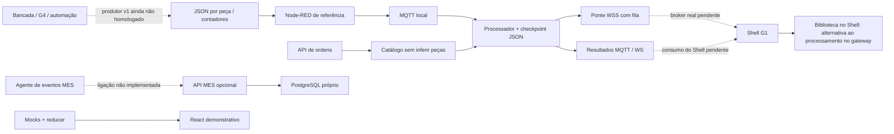

# 04 — Arquitetura e qualidade

Referência: 11/11/2026, base `consolidacao-sprint2@d7f1182`. **A separação de processamento e demonstração é consistente no código; o fluxo industrial completo ainda não está fechado.** Achados são estáticos salvo indicação explícita de CI remoto. Nenhum teste local, servidor, build ou script recebido foi executado.

## Estrutura e fluxo

```text
FrontEnd/
  src/domain + components + App.tsx   demonstração React/localStorage
  src/processing/                    biblioteca TS sem React ou sockets
  src/integration/                   GET ordens, DTOs e fonte legada
  tests/                             oito arquivos de testes de domínio/contrato
integration/
  node-red/                          runtime, geração de fluxo, ponte WSS
  api-mes/                           HTTP, repositório, driver pg e schema SQL
  plant/                             inspetor e mapa capturado de tags
  tests/                             quatro arquivos de testes de integração
.github/workflows/ci.yml              testes/builds no runner
compose.yaml                         Mosquitto e Node-RED locais
vercel.json                          saída estática da biblioteca
```



As setas tracejadas identificam integração pendente; não descrevem serviços em operação. É preciso escolher entre calcular no gateway ou no Shell, ou definir comparação de resultados sem somar contagens das duas instâncias. A configuração Vercel produz ESM e manifesto, sem index.html; abrir a raiz como se fosse dashboard não é critério adequado para esse artefato.

## Componentes e evidências

| Componente | O que existe | Limite relevante |
| --- | --- | --- |
| Frontend React | Cards, gráficos CSS, ordens, logística, CSV e impressão; estado inicial de mock e timers de simulação | App.tsx não conecta REST, biblioteca ou WS; rótulos de demonstração são explícitos. [FrontEnd/src/App.tsx:116](https://github.com/GabbeSant/smart40-expedicao-oee/blob/d7f11828d0304c1a1088309715d04b00ef8ec356/FrontEnd/src/App.tsx#L116) |
| Biblioteca | Eventos com versão, escopo, qualidade, sequência, validação, snapshots e funções matemáticas | Contrato v1 proposto; não prova conformidade ao contrato final G1. [FrontEnd/src/processing/contracts.ts:1](https://github.com/GabbeSant/smart40-expedicao-oee/blob/d7f11828d0304c1a1088309715d04b00ef8ec356/FrontEnd/src/processing/contracts.ts#L1) |
| Expedição | Aprovação/rejeição, etapas sequenciais, posições exclusivas e histórico | Modelo por peça; vínculo físico e unidade peça/lote ainda não homologados. [FrontEnd/src/processing/processor.ts:44](https://github.com/GabbeSant/smart40-expedicao-oee/blob/d7f11828d0304c1a1088309715d04b00ef8ec356/FrontEnd/src/processing/processor.ts#L44) |
| Ordens REST | GET fixo, origem configurável, timeout, cancelamento, erro tipado e validação de estrutura | Base padrão privada/HTTP; consumo externo exige gateway HTTPS e política do G1. [FrontEnd/src/integration/productionOrdersApi.ts:122](https://github.com/GabbeSant/smart40-expedicao-oee/blob/d7f11828d0304c1a1088309715d04b00ef8ec356/FrontEnd/src/integration/productionOrdersApi.ts#L122) |
| Node-RED | Fluxo gerado, MQTT QoS1, snapshots/WS, contexto expedition e diagnóstico | Não lê S7 por si; entrada de automação é Link In desconectado. [integration/node-red/flow.mjs:8](https://github.com/GabbeSant/smart40-expedicao-oee/blob/d7f11828d0304c1a1088309715d04b00ef8ec356/integration/node-red/flow.mjs#L8) |
| Ponte WSS | TLS, token por ambiente, heartbeat, backoff, fila persistida e comandos recebidos ignorados | Envio de socket não é confirmação de processamento no destino. [integration/node-red/brokerBridge.mjs:24](https://github.com/GabbeSant/smart40-expedicao-oee/blob/d7f11828d0304c1a1088309715d04b00ef8ec356/integration/node-red/brokerBridge.mjs#L24) |
| MES opcional | Cinco POSTs, três GETs, autenticação, isolamento por unidade, transação, idempotência e FK | Não é substituto integral do F4; nenhum produtor contínuo dessa API foi ligado no fluxo G5. [integration/api-mes/http.mjs:6](https://github.com/GabbeSant/smart40-expedicao-oee/blob/d7f11828d0304c1a1088309715d04b00ef8ec356/integration/api-mes/http.mjs#L6) |
| Persistência | localStorage na demo; checkpoint de ações no gateway; PostgreSQL no MES | Não foi identificado banco de séries temporais de KPIs nesta entrega; implantação externa não foi verificada. Os três armazenamentos têm finalidades diferentes. |
| Inspeção de planta | GET de settings/flows/contexto e assinatura WS de status; mapa de 59 tags | `n2.observation` é UNCERTAIN, sem timestamp de origem; não é evento de produção. [integration/plant/inspect.mjs:48](https://github.com/GabbeSant/smart40-expedicao-oee/blob/d7f11828d0304c1a1088309715d04b00ef8ec356/integration/plant/inspect.mjs#L48) |

## Pontos fortes confirmados no código

- Entrada `unknown` é validada antes de alterar estado; amostras BAD/UNCERTAIN e outro ativo/origem são rejeitadas.
- Há modos exclusivos de peças e contadores, baseline/época, deduplicação por evento e peça, e preservação das identidades após reset.
- Checkpoint é salvo antes de confirmar alteração interna; snapshots são cópias e não expõem estado mutável. Falhas não retornam silenciosamente a dados simulados no processador.
- OEE usa fatores percentuais coerentes e retorna null sem insumos; performance acima de 100% é sinalizada. A demonstração antiga limita esse fator: são modelos distintos e precisam permanecer identificados.
- O binding do Shell remove listeners/timer em dispose; a biblioteca não abre conexão paralela.
- MES cria o pai antes do evento, usa parâmetros SQL/transação e conflito409 para reuso de ID com conteúdo diferente; TLS pg é verificado por padrão.
- Compose publica portas apenas em localhost; Docker usa usuário node, editor desabilitado e instalação de novos módulos bloqueada no runtime de referência.
- Actions fixa os SHAs das actions e usa contents:read; dependências têm lockfiles.

Esses controles reduzem riscos, mas não demonstram o atendimento de SLAs físicos ou uma avaliação completa de segurança.

## Achados de qualidade e integração

| ID / gravidade / confiança | Evidência | Consequência e recomendação |
| --- | --- | --- |
| ARQ-001 · Alta · confirmada | Link In sem ligação em flow.mjs:8; tags e observação em inspect.mjs:69 | Existe um ponto de entrada, não um coletor contínuo por peça. Fechar produtor homologado antes de declarar integração real. |
| ARQ-002 · Alta · confirmada | processor.ts:119–122,162; runtime.mjs:10–14; snapshot:185–204 | Cada evento clona estado crescente, copia log e regrava todo o histórico; snapshots percorrem amostras/peças. Sem retenção/compactação, custo e espaço crescem com a sessão. Medir carga e definir checkpoint/arquivo de eventos, sem assumir um SLA já quebrado. |
| ARQ-003 · Alta · confirmada como limite | flow.mjs:18–22; brokerBridge.mjs:28–32 | Checkpoint e fila WSS não formam transação: queda após ingest e antes de enfileirar pode deixar encaminhamento pendente perdido até retransmissão externa. Fila é removida no callback de send, sem ACK de aplicação. Acordar outbox/replay/ACK com G1; QoS1 local não resolve toda a cadeia. |
| ARQ-004 · Alta · confirmada | websocket listeners em flow.mjs:56–57; README:102 | Eventos WS são só ao vivo. Cliente novo ou reconectado não recebe histórico completo. Consumir resultado persistido ou definir replay, evitando recontagem. |
| ARQ-005 · Alta · confirmada como incompatibilidade de dados | D03/f4e9b03da0bda32c envia componentId: 5; repository.mjs:13 limita1–4 | Parte do backup antigo será rejeitada pela API nova. Mapear componente real com automação antes de substituir serviços. |
| ARQ-006 · Alta · confirmada | tipos v1 versus snapshots e contratos preliminares; appShell.ts:13–22 | O roteador distingue presença de schemaVersion e não aceita resultados como entradas. O Shell precisa escolher eventos versus resultados; resultado /ws/expedition não pode ser enviado à função destinada a eventos de produção. |
| ARQ-007 · Média · risco condicionado | HTTP/WS locais em flow.mjs; start.mjs:41–50 | Editor protegido não autentica automaticamente os endpoints de resultados. Se NODE_RED_HOST for exposto fora da configuração localhost/Compose, é preciso proteção de rede/serviço. O padrão local atual não é evidência de exposição pública. |
| ARQ-008 · Média · confirmada | Node-RED 4.1.17 no lockfile versus3.0.2 relatado/mapa; functionGlobalContext exigido em runtime | Exportar JSON não exporta biblioteca/contexto. Compatibilidade de importação na bancada precisa ser testada; não se demonstrou incompatibilidade automática entre as versões. |
| ARQ-009 · Média · confirmada | processing/processor.ts:48–49 | eventId repetido é duplicate sem comparar conteúdo; sequência fora de ordem é rejeitada, sem reordenação. Produtor deve preservar IDs e ordenação. Se correções/replay fora de ordem forem exigidos, definir política explícita, distinta da idempotência409 do MES. |
| ARQ-010 · Média · confirmada | productionOrdersSource.ts:48–55 versus processing/orders.ts:20–24 | Fonte legada retorna mock identificado em falha; biblioteca preserva catálogo e propaga erro. Reutilizar a fonte errada em produção pode trocar origem. Manter adaptadores e contratos separados. |
| ARQ-011 · Média · confirmada | .github/workflows/ci.yml:23–28 | CI roda testes/builds, mas não lint, apesar de lint existir e o runbook exigi-lo. Incluir verificação depois, sob nova tarefa; não foi corrigido nesta auditoria. |
| ARQ-012 · Alta para entrega · confirmada | Dois statuses Vercel failure no SHA atual; API de inspeção404 | Publicação não está comprovada. Obter logs no projeto correto; não atribuir causa a configuração ou dependência sem log. |
| ARQ-013 · Média · confirmada | App.tsx:116–196 e imports; nenhum binding ao processador | Demonstração e biblioteca evoluem separadas. UI existente não verifica o processamento novo nem a integração G1. Se UI for mantida, revisar responsabilidades e conectar sob contrato aprovado. |
| ARQ-014 · Média · confirmada | DB/API MES separadas do fluxo; scope orders em repository.mjs:77 | Eventos de expedição não geram automaticamente eventos MES; métricas MES não fornecem qualidade de peças. Essa ligação exige definição de responsável e semântica. |
| ARQ-015 · Média · risco provável | jsonBody em http.mjs:13–15 lê todo o corpo antes de rejeitar tamanho; role write em todas as estações | Há limites de memória/timeout e auth, mas não rate limiting nem escopo por ação/estação. Dimensionar se houver exposição pública; não é prova de exploração nem bloqueio para demo local. |

### Dependências e configurações

Valores abaixo foram lidos dos lockfiles, sem instalar ou consultar um catálogo de vulnerabilidades:

| Artefato | Versões resolvidas relevantes | Implicação |
| --- | --- | --- |
| FrontEnd | React 19.3.0; Vite 8.3.1; TypeScript 6.0.3 | Todos os ramos compartilham essas versões relevantes. Vite exige ^20.19 ou >=22.12 no lock. Node 22 do CI funcionou. |
| Raiz da consolidação | Node-RED 4.1.17; MQTT 5.16.1; ws8.22.1; pg8.23.1 | Node>=22.18 exigido pelo projeto; pg é dependência de produção. |
| Runtime Node-RED | node-red e ws em devDependencies | Docker/execução documentados instalam dependências completas. Uma instalação genérica omitindo dev não basta para esse runtime; o blueprint MES pode omitir dev porque usa pg. |
| Cloud estática | vercel.json gera release/; CORS* para ESM público | Não é autenticação de API e não publica Node-RED/MQTT/MES. Os dois projetos Vercel precisam ter destino/raiz de build confirmados. |

Não foi demonstrada dependência vulnerável, obsoleta ou incompatível somente por seu número. Não se executou npm audit; o acervo de instaladores antigos do Drive não é a lista de dependências da biblioteca.

## Segurança: evidência e limites

D03 contém credencial de bot Telegram embutida em URLs de nós HTTP (por exemplo, nó896093332d346959). D06 e L13 também apresentam credenciais de instalação/exemplo; D03 tem arquivos de credenciais e configuração de usuários no backup. **Valores foram omitidos dos relatórios e não foram usados.** Não foi verificada validade atual, permissões de envio nem exploração. O custodiante deve avaliar revogação/rotação e distribuição dos arquivos originais; a auditoria não removeu nada.

Uma busca restrita por padrões de tokens GitHub, AWS access key, chave PEM e bot Telegram não encontrou correspondências nas quatro pontas Git. Isso **não prova ausência de segredos**, não cobre toda forma de credencial nem todos os blobs históricos. Não se confundiram endereços privados com segredos.

## Testes e confiança

O [CI do SHA d7f1182](https://github.com/GabbeSant/smart40-expedicao-oee/actions/runs/41947097185) confirma execução anterior com sucesso dos testes e builds. Inspeção dos 12 arquivos de testes encontrou cenários de D/P/Q, ausência de insumos, PPM móvel, contadores, duplicatas, checkpoint/reset, API/cancelamento, associação OP, listener/dispose, Node-RED, ponte WSS e MES/PGlite.

O teste Node-RED inicia processos e brokers de laboratório; o MES usa PostgreSQL embarcado PGlite. Isso é mais evidência que nomes de arquivos, mas **não valida** PostgreSQL hospedado, Shell real, rede industrial, RFID físico, browser/UI atual, SLAs de latência ou comportamento com notebook real desligado. Relatos G02/G05/G11 desses ambientes são históricos, não repetidos aqui. Não foram abertos servidores ou instaladas dependências para estender essa verificação.

