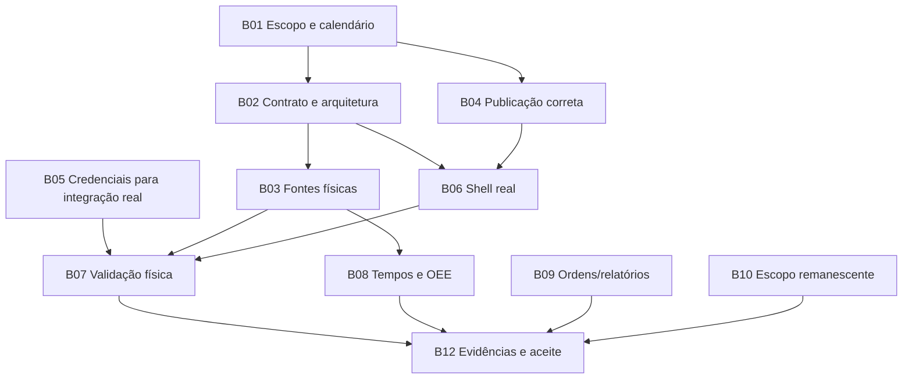

# 07 — Diagnóstico e plano de continuidade

Referência: 11/11/2026. Este documento é um **plano para trabalho futuro**. Nenhuma tarefa abaixo autoriza ou registra implementação, merge, deploy, rotação de credenciais ou alteração nos originais durante a auditoria.

## Diagnóstico: respostas às 12 perguntas

| Questão | Resposta fundamentada |
| --- | --- |
|1. Objetivo real | Supervisionar a etapa final, relacionar ordens e fluxo de saída e transformar dados de produção em indicadores de eficiência/produtividade para a aplicação integrada. L06 p.4; L12 pp.2,10. |
|2. Responsabilidades G5 | Expedição, contadores/PPM/fila, ordens e OEE. MTBF/relatórios constam da especificação. Tela aparece em várias fontes; dispensa só em relato do repositório. MES próprio é G5 ouG1. |
|3. Obrigatório | Escopo expresso e rubrica de L06, integração/contrato e entregas por etapa. Não existe base para dispensar itens por conta própria ou exigir todos os exemplos dos ZIPs. Matriz 32 itens em 06. |
|4. Divergências | Q chamado OEE, múltiplos contratos, sem tela, manter/substituir Node-RED/Elipse, redes/rotas, SLAs/calendário e exemplos quebrados. INC-001–018. |
|5. Desenvolvido | Demo React; leitura REST isolada; biblioteca v1 com expedição/cálculos; gateway Node-RED/MQTT/WSS; API MES opcional; testes e CI. Código e limites em 04/05. |
|6. Base | consolidacao-sprint2@d7f1182, com ponta local igual à remota. CI confirmado; publicação falhou. |
|7. Reaproveitar | teste já está contida; preservar demo se mantida no escopo; ideias de proveniência/UI de teste2 somente seletivamente. Não portar exemplos defeituosos dos anexos. |
|8. Incompleto | Contrato final, produtor por peça, qualidade/tempos reais, integração G1, publicação e aceite; MTBF sem cálculo. |
|9. Riscos | Entregar artefato diferente da rubrica, indicadores sem insumos, credenciais no acervo, perda/replay na cadeia e crescimento de checkpoint. |
|10. Integrações | Automação/G4→eventos, contrato/barramento G1↔biblioteca, catálogo de OP, artefato estático e broker real; MES→PostgreSQL/cliente somente se atribuído. |
|11. Dúvidas ao professor | Formato de entrega, fórmula OEE, donos de UI/MES, critérios de turno/qualidade, SLAs e calendário. Perguntas abaixo. |
|12. Próximos passos | Primeiro decisões acadêmicas/contrato e dados; depois fluxo integrado/publicação e evidências. Melhorias adicionais vêm após atender os essenciais. |

## Prioridade e dependências

P0 bloqueia conclusão técnica ou avaliação; inclui decisões pendentes, não apenas defeitos de software. P1 é essencial documentado, condicionado às dispensas/atribuições que o professor formalizar. P2 melhora confiabilidade/qualidade e pode subir de prioridade se a rubrica exigir a garantia. P3 não deve comprometer a entrega.

## P0 — Bloqueadores

| ID | Tarefa | Justificativa | Responsável proposto | Dependências | Critério objetivo de conclusão |
| --- | --- | --- | --- | --- | --- |
| B01 | Fechar escopo, rubrica e calendário com professor | INC-003/012; UI, MTBF e datas mudam a avaliação. | Professor + G5/G1 | Nenhuma | Decisão escrita identifica entrega G5 com/sem UI, dono dos gráficos/relatórios/MES, fórmula OEE, prazo Sprint2/final e critérios dispensados ou mantidos. |
| B02 | Congelar contrato G1 e local de processamento | INC-002/004; formatos incompatíveis e risco de dupla contagem. | G1 + G5 + automação | B01 | Versão/SHA do contrato, fixtures válidas/inválidas, tópico/evento de entrada/saída, unidade/ativo/origem e um modo escolhido: eventos no Shell ou resultados no gateway; um publicador de unidade identificado. |
| B03 | Homologar mapa físico e eventos por ocorrência | REQ-020/029/031; observação não prova produção/qualidade. | Automação + G4 + G5 | B01/B02 | Tabela sinal→semântica→unidade→qualidade→timestamp→responsável aprovada; produtor envia sequência conhecida de peças boas/rejeitadas e movimentos sem deduzir peças de OP/magazine; casos sem dados permanecem N/D. |
| B04 | Resolver publicação da revisão escolhida | Dois deployments failure; logs404 nesta auditoria. | Responsável pelos projetos + G5/G1 | Acesso aos logs e B01/B02 para escolher artefato | Logs da falha identificam causa; build/publicação sob nova solicitação produz URL do artefato correto, SHA auditável e importação bem-sucedida pelo consumidor. Não basta CI verde ou raiz de site aberta. |
| B05 | Resolver credenciais expostas antes de usar integração real | D03 tem token em URL; estado de validade desconhecido. | Custodiante OT/serviços | Acesso do custodiante; paralelizável com B01 | Custodiante registra revogação/rotação ou comprova inutilização das credenciais afetadas, restringe distribuição dos originais e provisiona segredos por ambiente/papel sem repeti-los em código, tickets ou relatórios. Mocks podem continuar isolados. |

## P1 — Essenciais

| ID | Tarefa | Justificativa | Responsável proposto | Dependências | Critério objetivo de conclusão |
| --- | --- | --- | --- | --- | --- |
| B06 | Integrar biblioteca ao Shell da turma | REQ-012/014; binding isolado não comprova aplicação integrada. | G1 + G5 | B02/B04 | Um fluxo de entrada homologado atualiza resultados no Shell real; alternar módulo não duplica listeners/timers ou sockets; origem, timestamps e estado desconectado são visíveis ao consumidor. |
| B07 | Validar contagem e logística na bancada | REQ-001/002/004/005/020; ligar eventos não basta. | G5 + G4 + automação | B03/B06; sessão técnica autorizada | Roteiro com conjunto enumerado de passagens e posições: total=boas+rejeitadas, rejeitadas não armazenadas, posição exclusiva e saída correspondente; duplicação/retransmissão e reinício não alteram os totais esperados. |
| B08 | Fornecer tempos/ciclo e homologar OEE/PPM | REQ-003/006/029; insumos reais ausentes. | G5 + professor + automação | B01/B03 | Calendário e ciclo por produto definidos; exemplos de cálculo independente concordam com D/P/Q/OEE; Q não é rotulado OEE completo; ausência e troca de turno não fabricam valores; janela PPM documentada. |
| B09 | Concluir ordens e relatórios no responsável acordado | REQ-009/010; demo não é gestão real. | G5 ou G1 conforme B01 | B01/B02/B03 | Estados1/2/3 e aliases mapeados sem confundir id/trackingCode; casos de fila/produção/finalizada demonstrados; PDF/CSV, se mantidos, usam dados do fluxo aceito, com origem/período e campos definidos. |
| B10 | Entregar UI/histórico/MTBF remanescentes ou formalizar dispensa | REQ-008/011/017; exigências originais não podem desaparecer por README. | Professor + G5/G1 | B01/B08 | Cada requisito é atendido com evidência ou dispensado expressamente. Para MTBF mantido: definição de falha/operação e cenário manualmente calculado; para UI: gráficos/histórico apresentados pelo dono acordado. |
| B11 | Decidir e integrar MES, se atribuído | REQ-025 e INC-016/017; banco/cliente real ausentes. | G5 ou G1, com automação | B01/B02/B05 | Dono e fronteira aprovados; componentes canônicos corrigidos no produtor; cinco eventos/consultas validados com PostgreSQL alvo, autenticação e isolamento; ordens do MES não viram peças de OEE. Sem atribuição, registrar API apenas opcional. |
| B12 | Preparar evidências e aceite acadêmico integrado | Rubrica L06 p.5; demonstração necessária. | Todos; G1 coordena | B06–B10 e B11 se obrigatório | Pacote com SHAs, URLs, diagrama, contratos, README, dados/roteiro e resultados por requisito; professor registra aceite/pendência; teste de notebook desligado/religado feito se Caminho A for adotado. |

## P2 — Melhorias

| ID | Tarefa | Justificativa | Responsável proposto | Dependências | Critério objetivo de conclusão |
| --- | --- | --- | --- | --- | --- |
| B13 | Definir ACK, outbox e replay de ponta a ponta | ARQ-003/004; janelas de perda entre checkpoint e saída. | G1 + G5 + gateway | B02; promover a P0 se contagem sem perda for critério obrigatório | Falha injetada antes/depois de cada gravação/envio recupera o mesmo conjunto de eventos, sem omissão/contagem duplicada; ACK indica persistência no destino e replay recupera consumidor novo. |
| B14 | Dimensionar checkpoint e retenção | ARQ-002; log e cópias sem limite. | G5 | B03/B08 e volume/duração esperados | Carga representativa do turno mede CPU, memória, disco e latência; retenção/compactação preserva deduplicação e histórico exigidos; limites e recuperação de disco cheio documentados. |
| B15 | Completar verificações e medição dos SLAs | ARQ-011 e INC-011; CI não roda lint nem mede browser/planta. | G5 + G1 | B01/B06; testes adicionais só após alteração/risco definido | Lint incluído no gate; teste integrado cobre contrato real; metas de latência têm fronteira/carga/percentil acordados e medidos; relatório distingue CI, browser e bancada. Não afirmar 100 ms pelo nome do teste. |
| B16 | Unificar documentação de execução e pendências | INC-018; guias antigos sobre status/Node confundem. | G5 | B01/B02 | Um guia por artefato aponta versão Node validada e contrato vigente, distingue demo/biblioteca/MES/gateway e elimina pendências já resolvidas com referência à evidência; documentos históricos ficam identificados. |
| B17 | Concluir lotes documentais e confirmar backups | Inventário parcial; RAR/manuais/binários ainda não analisados. | G5 + técnico | Disponibilidade de exportações legíveis; sem executar binários | Pastas pendentes inventariadas com limites/paginação, material relevante do TIA exportado para leitura e backup canônico identificado; ampliar requisitos só após evidência nova. Revisão do RAR separada, sem presumir conteúdo. |

## P3 — Opcionais

| ID | Tarefa | Justificativa | Responsável proposto | Dependências | Critério objetivo de conclusão |
| --- | --- | --- | --- | --- | --- |
| B18 | Evoluir UI observacional a partir de teste2 | Reaproveitamento possível, sem ganho obrigatório comprovado. | Dono da UI | B01, essenciais aceitos | Integração seletiva do modelo de leituras/qualidade ao contrato final; nenhuma aplicação duplicada importada; tarefas opcionais não atrasam o aceite. |
| B19 | Adicionar análises entre turnos e exportações avançadas | Valor adicional além do histórico mínimo aprovado. | G5/G1 | B08/B10/B14 e aceite essencial | Consultas têm períodos/fuso/origem explícitos e resultados conferíveis; escopo adicional aprovado. Banco de séries só obrigatório se B01 confirmar L11 literalmente. |
| B20 | Comparar opções extras de protocolo/hospedagem | MQTT/OPCUA/S7 são opções, não requisitos cumulativos. | G1 + automação | Arquitetura principal estável e B12 | Experimento isolado documenta custo/benefício sem trocar contrato nem duplicar publicação. Não migrar infraestrutura apenas por preferência técnica. |

## Perguntas a encaminhar ao professor e à integração

1. O G5 está dispensado de tela própria? Quem apresenta os indicadores, histórico, OPs e relatório e como isso será avaliado nos 15% de UX?
2. Quais itens de L06 p.4 permanecem obrigatórios: MTBF, scrap, OPs ativas/fila e PDF/CSV? PDF significa impressão do navegador ou geração específica?
3. O indicador avaliado será D×P×Q, apenas Q do exemplo da Sprint2, ou ambos com rótulos diferentes?
4. Qual o período de apuração, calendário/pausas, ciclo ideal por produto e tratamento de mix, retrabalho e reinício de contadores?
5. Quem fornece identidade da ocorrência e aprovação/rejeição: G4, RFID, MES ou outra fonte documentada? Uma OP representa quantas peças nesse modelo?
6. Qual é o `contrato-global.ts` aprovado e sua versão/SHA? G1 consumirá eventos v1 ou resultados já calculados?
7. A turma adotará Node-RED/Elipse existentes ou Caminho A com APIs próprias? Quem será o único publicador da unidade?
8. API MES e PostgreSQL pertencem ao G5 ouG1? As três consultas novas são parte do acordo? O5 do fluxo antigo é configuração válida ou resíduo?
9. Os IPs192.168.0.x e endpoints OEE do checklist são exemplos? OAuth2 e banco de séries são exigências literais ou uma solução sugerida?
10. Os SLAs são medidos do sinal físico, da chegada ao barramento ou do cálculo até a tela? Qual meta de reconexão prevalece:3 s ou30 s?
11. Qual prazo oficial de Sprint2/final e qual evidência concede a extensão até 09/12? A matriz “Aprovado” do checklist é só modelo?
12. Quem valida a semântica das tags e autoriza a sessão física de comparação? Qual backup e projeto TIA correspondem à bancada atual?

Essas perguntas estão documentadas para encaminhamento pelo usuário; **nenhuma mensagem foi enviada a terceiros**.

## Sequência sugerida e critério de parada

Em11/11/2026, o cronograma datado L04 coloca a turma na fase de integração04–17/11, seguida de teste real18–24/11. Restam 13 dias de calendário até 24/11; a alternativa09/12 é proposta, não prazo concedido. Não há data oficial inequívoca da Sprint2 nas fontes obtidas.

As cinco primeiras ações de coordenação são: **B01 escopo**, **B02 contrato**, **B03 fontes**, **B04 publicação** e **B05 credenciais antes da integração real**. Parte pode ser tratada em paralelo por responsáveis humanos; nenhuma ordem implica executar comandos agora.

Só declarar entrega concluída quando requisitos mantidos tiverem evidência no ambiente acordado, a URL/importação da revisão estiver comprovada e o professor registrar aceite ou exceções. Se dados físicos não forem disponibilizados, apresentar demonstração explicitamente simulada e lacunas aceitas, sem chamar isso de OEE real ou homologação industrial.

A auditoria termina nos relatórios. Implementação, publicação, novos testes que executem o projeto e alterações de branches aguardam nova solicitação.

