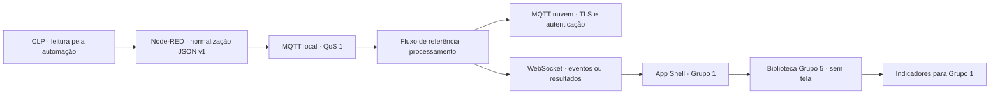

# SMART 4.0 — Grupo 5 · Processamento de Expedição e OEE

**Para continuar no próximo dia de trabalho:** ler [RETOMADA-TRABALHO.md](RETOMADA-TRABALHO.md), que reúne estado atual, validação, acesso à bancada e próximas ações.

A entrega da Sprint 2 é uma biblioteca TypeScript **sem tela própria**. Recebe eventos, valida e deduplica peças, acompanha a expedição e fornece indicadores ao App Shell do Grupo 1. O React existente permanece como demonstração local e não integra o pacote de entrega.

O escopo segue a orientação mais recente do professor, reproduzida na conversa fornecida pelo usuário. A pasta `FrontEnd/docs` não foi usada como requisito desta implementação.

Os PDFs adicionais esclareceram o barramento `smart40:telemetria`, o broker WSS do Caminho A e a API MES. A [análise dos PDFs](ANALISE-PDFS-SPRINT2.md) registra as compatibilidades, os erros encontrados e as correções. A [API MES opcional](integration/api-mes/README.md) já implementa os cinco eventos, sem alterar a biblioteca sem tela.

A [conexão com a bancada](CONEXAO-BANCADA.md) foi verificada pela rede Smart 4.0: Node-RED 3.0.2, leitura S7 online e API de ordens acessível. `npm run plant:inspect` repete a inspeção em modo de leitura. O mapa real está em `integration/plant/n2-expedition-tags.json`; o adaptador resolve o número de OP do CLP pelo código/trackingCode, sem confundi-lo com o id da API.

## Executar e verificar

Na raiz, com Node.js 22.18+ (Node 24+ para a demonstração Vite):

```sh
npm ci
npm --prefix FrontEnd ci
npm test
npm run test:e2e
npm run build:release
```

No PowerShell com scripts bloqueados, use `npm.cmd`. O teste integrado cria brokers locais, executa o **Node-RED real**, valida TLS/autenticação em uma nuvem simulada, entrega eventos ao Shell e verifica persistência após reinício. Não acessa a bancada ou brokers públicos.

`release/` contém o módulo ESM `processing/index.js`, suas declarações TypeScript, `manifest.json` e os fluxos `flows.local.json` e `flows.cloud.json`. Não há HTML ou React nesse pacote.

Os fluxos exportados usam `functionGlobalContext.expedition`, configurado por `integration/node-red/start.mjs`. Para importá-los em outra instalação Node-RED, é necessário instalar a biblioteca e portar esse contexto de execução.

## Consumir no Grupo 1

Importe `FrontEnd/src/processing/index.ts` no monorepo, instale `release/` como pacote local ou hospede seus arquivos ESM. A importação não abre sockets nem registra listeners.

```ts
import {
  createExpeditionProcessor, attachExpeditionToShell,
  dispatchSmart40Telemetry, EXPEDITION_CONNECTION_EVENT,
  EXPEDITION_METRICS_EVENT,
} from '@smart40/expedition-processing';

const processor = createExpeditionProcessor({
  unitId: 'UNIDADE-SP', assetId: 'N2-EXPEDICAO', origin: 'medido',
  productionMode: 'pieces',
  // O Shell fornece armazenamento durável por ativo e origem:
  // storage: { load: () => checkpoint, save: serialized => persist(serialized) },
});
window.addEventListener(EXPEDITION_METRICS_EVENT, event => {
  const snapshot = (event as CustomEvent).detail;
  console.log(snapshot.totalProduced, snapshot.oee, snapshot.ppm);
});
const binding = attachExpeditionToShell({ target: window, processor });

// Nos callbacks da conexão central JÁ pertencente ao Shell:
// onmessage: dispatchSmart40Telemetry(window, data);
// onopen: window.dispatchEvent(new CustomEvent(EXPEDITION_CONNECTION_EVENT,
//   { detail: 'CONNECTED' }));
// onclose/onerror: idem com 'DISCONNECTED'.
// Ao desmontar: binding.dispose();
```

`storage.save` é síncrono e deve concluir antes da confirmação. Sem armazenamento fornecido pelo hospedeiro, o estado é apenas de memória. O runtime Node-RED usa arquivo com escrita atômica. Checkpoint inválido gera erro e é preservado, sem retorno silencioso a mocks.

O contrato está em [contracts.ts](FrontEnd/src/processing/contracts.ts), as regras em [processor.ts](FrontEnd/src/processing/processor.ts) e os eventos em [appShell.ts](FrontEnd/src/processing/appShell.ts). O JSON v1 e os nomes de eventos são uma **proposta implementada e testada**, ainda sujeita à confirmação do Grupo 1 e da automação.

O nome global `smart40:telemetria` está documentado nos PDFs; a extensão v1 de eventos continua sujeita a acordo. Para snapshots legados, `attachExpeditionToShell` aceita `projectTelemetry: { unitId, assetId, origin, quality, counterEpoch? }`. A qualidade da fonte precisa ser declarada explicitamente, e contadores exigem `productionMode: 'counters'` e época conhecida. Snapshots de magazine/estado não geram produção fictícia. `snapshot.oeeSimplified` entrega a fórmula de FFE p.9 (qualidade); `snapshot.oee` entrega D×P×Q quando houver insumos.

## Node-RED, MQTT e nuvem



O fluxo inclui um processador no gateway para execução independente e validação. Na turma, o Grupo 1 pode executar a biblioteca com os eventos ou consumir os resultados prontos do gateway. Não deve somar os dois. Cada instância é exclusiva para uma unidade, ativo e origem.

Copie `integration/node-red/.env.example` para `.env` **na mesma pasta** e configure localmente. Com um broker MQTT disponível:

```sh
npm run build
npm run node-red
```

Com Docker, após criar o `.env`, execute `docker compose up --build -d`. O Compose inclui Mosquitto e Node-RED, volumes persistentes e portas publicadas somente em localhost. A configuração anônima do Mosquitto serve à demonstração local; o broker da turma deve usar autenticação e ACL próprias.

| Recurso | Endereço padrão |
| --- | --- |
| Diagnóstico | `http://127.0.0.1:1880/health` |
| Editor, se habilitado | `http://127.0.0.1:1880/red` |
| Eventos para a conexão central do Shell | `ws://127.0.0.1:1880/ws/telemetry` |
| Resultados `{type: "expedition.metrics", data: snapshot}` | `ws://127.0.0.1:1880/ws/expedition` |
| MQTT de entrada | `smart40/UNIDADE-SP/N2-EXPEDICAO/telemetry` |
| MQTT de resultados | `smart40/UNIDADE-SP/N2-EXPEDICAO/metrics` |

Resultados MQTT usam retained; eventos de peças não. O Shell verifica `computedAt`, observa desconexões e mantém checkpoint. O WebSocket de eventos é ao vivo e não reproduz histórico para clientes novos. Para retomada completa, consuma snapshots do processador persistido do gateway ou combine replay com o Grupo 1.

Para demonstração, use `DATA_ORIGIN=simulado` no `.env`, inicie o runtime e execute `npm run demo:mqtt` em outro terminal. Serão enviadas duas peças, uma duplicata intencional e as etapas de uma saída. A origem `medido` recusa eventos simulados; não misture simulação e produção no mesmo checkpoint.

O armazenamento padrão separa unidade, ativo, origem e modo em subpastas de `integration/node-red/data/`. Se definir `NODE_RED_DATA_DIR`, use um diretório exclusivo para cada instância.

Quando houver broker de nuvem, preencha `MQTT_CLOUD_HOST`, `MQTT_CLOUD_USERNAME`, `MQTT_CLOUD_PASSWORD` no **ambiente do Node-RED** e use `MQTT_CLOUD_ENABLED=true`. A porta padrão é 8883, com verificação de certificado e hostname. A ponte envia telemetria/resultados local → nuvem, sem assinar de volta os próprios tópicos. Credenciais não entram no frontend ou nos arquivos versionados. `/health` informa o estado da nuvem. Clientes do Grupo 1 precisam de credenciais próprias de leitura; no navegador, MQTT exige o endpoint WSS do broker.

A automação conecta sua leitura ao Link In **“Entrada da automação: JSON v1 normalizado”**. Os novos PDFs propõem S7 e trazem endereços DB1 ilustrativos; o mapa do programa real e a configuração de acesso ao CLP ainda precisam ser homologados. Os exemplos não foram usados para acessar a bancada.

Para o broker **WebSocket** do Caminho A, configure `BROKER_URL` e `TOKEN_AGENTE` no ambiente do Node-RED. Isso é diferente de `MQTT_CLOUD_HOST`. A ponte de saída usa WSS com token, reconexão, heartbeat e fila pendente em disco; não executa comandos recebidos. O Shell continua com uma única conexão e usa `dispatchSmart40Telemetry` para separar eventos G5 dos snapshots dos demais módulos. Não mantenha o agente do Grupo 1 e esta ponte com o mesmo token de agente; a escolha do publicador pertence à integração da turma. O teste usa uma instância local autenticada, não a URL ilustrativa dos PDFs.

## Entrega e publicação

[ENTREGA-SPRINT2.md](ENTREGA-SPRINT2.md) detalha regras, cálculos e pendências. O workflow de CI executa testes, integração e builds. `vercel.json` prepara a hospedagem **estática da biblioteca**, com CORS para importação pelo Shell. Node-RED e MQTT são processos persistentes separados dessa hospedagem.

O projeto Vercel deve usar a raiz do repositório. Publicação e integração com o Shell real dependem de um destino confirmado e do contrato da turma. O código desta entrega é reunido na branch `consolidacao-sprint2`; o envio ao GitHub não equivale a deploy dos serviços ou merge na main. Consultar [RETOMADA-TRABALHO.md](RETOMADA-TRABALHO.md) para as pendências de integração e publicação.
